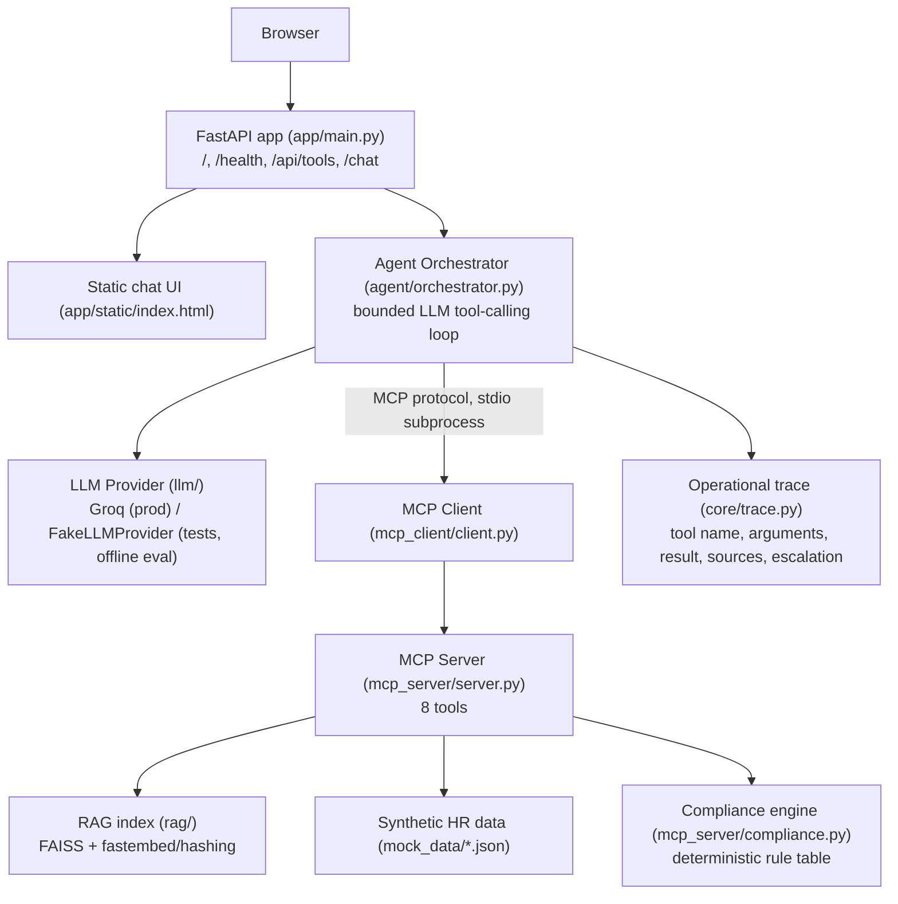

# Architecture

This reflects the actual implementation (Phases 1-4), not a proposal.
See `design-and-evaluation.md` for the full rationale behind every piece
below; this file is the diagram-first quick reference.



Text form, for anywhere Mermaid isn't rendered:

```text
Browser
   |
   v
FastAPI (app/main.py)  --serves--> Static chat UI (app/static/index.html)
   |
   v
Agent Orchestrator (agent/orchestrator.py)
   |                                  \
   v                                   v
LLM Provider (llm/)                MCP Client (mcp_client/client.py)
  Groq (prod) / FakeLLMProvider       | stdio (subprocess)
  (tests/offline eval)                v
                                    MCP Server (mcp_server/server.py, 8 tools)
                                       |            |
                                       v            v
                              RAG index         Synthetic HR data
                          (rag/, FAISS +      (mock_data/*.json via
                           fastembed/hashing)   mock_data/loader.py)
                                       |
                                       v
                          Compliance engine (mcp_server/compliance.py)
```

Every arrow is a real, load-bearing dependency: `AgentOrchestrator` never
imports `mcp_server.tools` directly -- it only calls tools through
`MCPClient` over the real Model Context Protocol (stdio transport) to the
separate `mcp_server.server` subprocess, which is the only component that
touches `rag/`, `mock_data/`, and `mcp_server/compliance.py`.

## RAG
Policy documents are ingested, cleaned, chunked, embedded, and persisted
locally (FAISS). Chunks retain document ID/title, section heading, source
path, and snippet. Retrieval returns top-k evidence (default `top_k=5`;
see `design-and-evaluation.md` section 10.3 for the top_k=3-vs-5
ablation). Final policy claims are grounded in retrieved evidence and cite
document/section identifiers -- citations are compiled only from real MCP
tool results (`agent/tool_results.py`), never parsed from model prose.

## Agent behavior
The orchestrator hands the LLM the discovered MCP tool schemas and the
conversation so far on every iteration; the LLM alone decides whether to
call a tool (and which, with what arguments), ask a clarifying question,
or give a final answer -- there is no `if PTO: call A; call B` branching
in `agent/orchestrator.py`. A hard iteration cap (`DEFAULT_MAX_ITERATIONS = 10`)
prevents an unbounded loop. See `design-and-evaluation.md` section 9.2 for
the two required demo workflows' expected (not hard-coded) tool sequences.

## Operational trace
Each `TraceStep` (`core/trace.py`) records: tool name, arguments, success/error
status, a concise result summary, retrieved sources, and any escalation --
never the model's internal reasoning text. Returned as part of every
`/chat` response's `trace` field.

## Action safety
`create_mock_hr_ticket` is gated in code (`agent/orchestrator.py`'s
`_CONFIRMATION_GATED_TOOLS`), not just by prompting: a `confirmed=true`
call is downgraded to `confirmed=false` unless the immediately preceding
turn in that conversation was itself a confirmation offer. `draft_hr_email`
always returns a labeled draft and never claims an email was sent.

## Demo workflows
### PTO
`lookup_employee_profile` -> `check_pto_balance` -> `search_policy_documents`
-> `check_policy_compliance` -> grounded answer (no ticket/email created
automatically).

### Remote work
`lookup_employee_profile` -> `search_policy_documents` across remote-work
and location policies (a real multi-document case) -> `check_policy_compliance`
-> escalation/next steps when approval is required.
